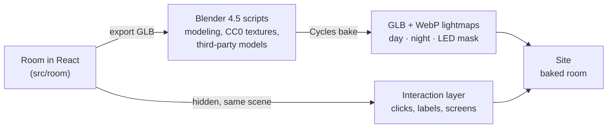

# Daniel Oliveira · 3D Room Portfolio

**A portfolio you walk into.** My real bedroom, rebuilt in 3D: every object opens a part of my professional story and the camera flies to it.

**Live:** [www.danielolv.dev](https://www.danielolv.dev) · **How it was made:** [case study](docs/estudo-de-caso/README.md) · **Português:** [README.pt-BR.md](README.pt-BR.md)


## What's inside

| Object in the room | Opens | How it looks |
| --- | --- | --- |
| Monitor | **Projects** | My GitHub profile as it is today: profile README, pinned repos, contribution graph and every public repository, fetched at build time |
| TV | **Experience** | My LinkedIn profile: headline, about, experience, education, licenses & certifications and skills |
| Phone on the bed | **Contact** | An iPhone-style home screen; the Mail app is a real contact form (EmailJS) |
| Photo frame on the shelf | **About me** | Who I am, what I study and what I like |
| The "&" lamp | **Day / night** | Switches between a golden late-afternoon and a rainy city night |

There is also a **2D mode** with the same content as a regular page (for weaker phones, screen readers and anyone who just wants to read), and everything is available in **Portuguese and English**.

<table>
  <tr>
    <td></td>
    <td></td>
  </tr>
</table>

## Highlights

- **Baked lighting.** The light is rendered offline in Blender (Cycles) by a scripted pipeline: one lightmap for the day, one for the night and a mask for the LEDs. The browser just paints textures, so there are no real-time lights at all.
- **Code stays the source of truth.** The room is first laid out in React (`src/room/`). A script exports it, Blender scripts model the detailed pieces and swap in ready-made models, and the bake comes back as a GLB. Re-baking the whole room is one command.
- **Invisible interaction layer.** The room built in code stays mounted, but hidden, on top of the baked one. It handles clicks, labels, hover and the moving chair, and the baked meshes copy its movement.
- **Live screens.** When the camera parks in front of the monitor, TV or phone, an HTML layer is placed exactly over the 3D screen. Before that, a canvas texture draws the same page, with colors calibrated against tone mapping, so the swap doesn't jump.
- **Real data.** `scripts/github.mjs` runs before every build and pulls my GitHub profile, pinned repos, profile README, avatar and contribution calendar. If GitHub is down, the last saved copy is used.
- **A window that is alive.** A golden sun by day and a rainy city by night, drawn live (`src/room/WindowView.jsx`).
- **Fast loading.** The room starts downloading before React mounts, with a real progress bar. Every room file is versioned (`?v=`) and cached for a year. Phones get a lighter GLB (5 MB instead of 12.6 MB).
- **Shareable.** Open Graph card, structured data (schema.org `Person`), sitemap, and plain-text content for crawlers and browsers without JavaScript.

## How it's built



### Tech stack

- **Web:** React 18, Vite 6, three.js 0.164, React Three Fiber 8, drei 9, camera-controls, postprocessing, EmailJS
- **3D:** Blender 4.5 LTS driven by Python scripts (`pipeline/blender/`), Cycles baking, WebP textures, Draco
- **Tooling:** ESLint 9, Prettier 3, Playwright (screenshots, performance and inventory scripts), GitHub Actions
- **Hosting:** Vercel, with a custom domain

### Project structure

```
src/
  app/        page shell: top bar, panels, loading, theme and language
  scene/      Canvas, camera rig (one viewpoint per section), effects
  room/       the room built in code (interaction layer + bake source)
  baked/      the baked room: loading, materials, progress
  screens/    monitor (GitHub), TV (LinkedIn) and phone (iOS) screens
  sections/   About, Projects, Experience, Contact, Credits (panel and 2D mode)
  content/    all the text in PT and EN, GitHub data, LinkedIn data
pipeline/     export → Blender → bake → optimize (see pipeline/README.md)
scripts/      GitHub data, screenshots, link preview image, performance
docs/         plan, credits, metrics and history
```

## Running locally

```bash
npm install
npm run dev        # http://localhost:5173
npm run check      # lint + formatting + build (the same as CI)
```

The contact form needs an [EmailJS](https://www.emailjs.com) account. Copy `.env.example` to `.env.local` and fill in `VITE_EMAILJS_SERVICE_ID`, `VITE_EMAILJS_TEMPLATE_ID_FOR_ME`, `VITE_EMAILJS_TEMPLATE_ID_FOR_SENDER` and `VITE_EMAILJS_PUBLIC_KEY`. Without them, the form says sending isn't configured.

Re-baking the room needs Blender 4.5 LTS and, ideally, an NVIDIA GPU: `npm run previa` gives a quick preview, and `npm run bake` runs the full bake (about an hour). The step-by-step guide is in [`pipeline/README.md`](pipeline/README.md).

## Performance

Version 1, with real-time lights, had **459 draw calls** and ran at **37 FPS** on a simulated phone (4× CPU slowdown). Today, with baked light, real models and textures, it has **162 draw calls** and runs at **87 FPS** on the same test (measured on 2026-10-23). The whole story is in the [case study](docs/estudo-de-caso/README.md), and the measurements are in [`docs/metricas/`](docs/metricas/).

## Credits

The 3D models from Sketchfab are used under **[CC BY 4.0](https://creativecommons.org/licenses/by/4.0/)**:

- Pioneer DJ console by twopixels.studio
- KRK Classic 5 by TheGiwi
- Ps5 by kiarash8585
- JBL Charge 3 by Oleksii.Rozumnyi
- Deadpool Funko Pop by JJTale
- funko harry potter by deathcow
- Fleetwood Bounder by Zack_Hawley
- Nike SB Dunk Low Chunky Dunky by ShoesPlug

Textures and models from [Poly Haven](https://polyhaven.com) are **CC0**. All the models were rescaled, reduced and converted to glTF, and the JBL was also recolored. The full list with links is in [`docs/creditos.md`](docs/creditos.md) and behind the **Credits** button on the site.

I studied [Bruno Simon](https://bruno-simon.com/), [Henry Heffernan](https://henryheffernan.com/) and [Room_Portfolio](https://github.com/AT010303/Room_Portfolio) for ideas. Room_Portfolio has no license, so nothing was copied from it: the techniques were reimplemented from scratch.

## License

The code is under the [MIT License](LICENSE). Third-party models and textures keep their own licenses (see above).

## Author

**Daniel Oliveira de Menezes**: Software Engineering student at PUC Minas and Full Stack Developer intern at Teknisa.
[LinkedIn](https://www.linkedin.com/in/daniel-oliveira14/) · [GitHub](https://github.com/Danielolv14) · [danielolv.dev](https://www.danielolv.dev)

This project started as LAB01 of the Web Application Development and Integration course at PUC Minas and grew into my professional portfolio.
