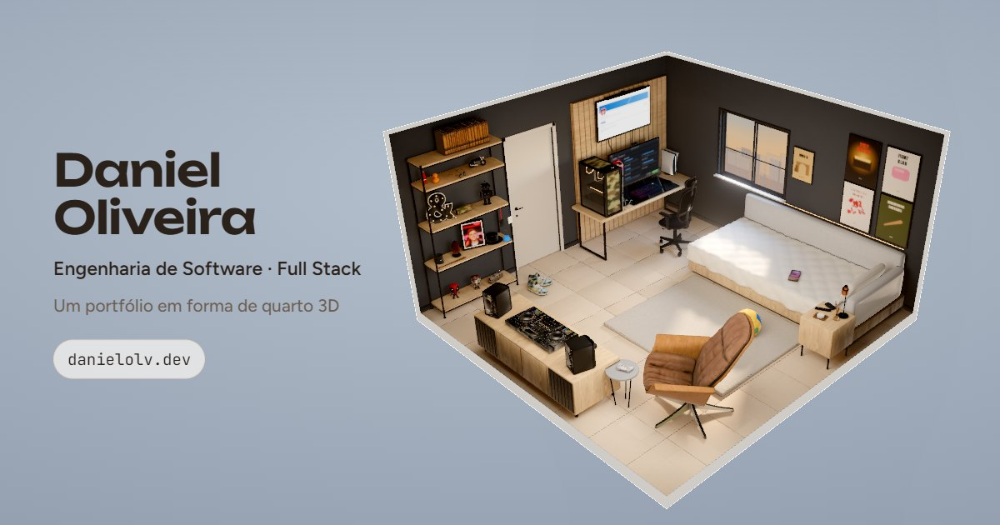
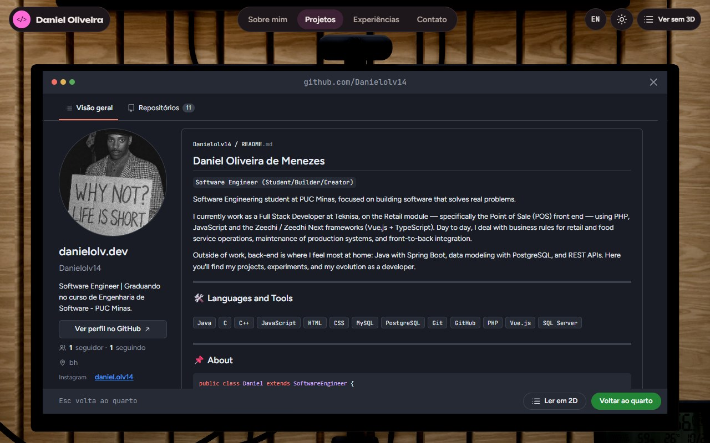
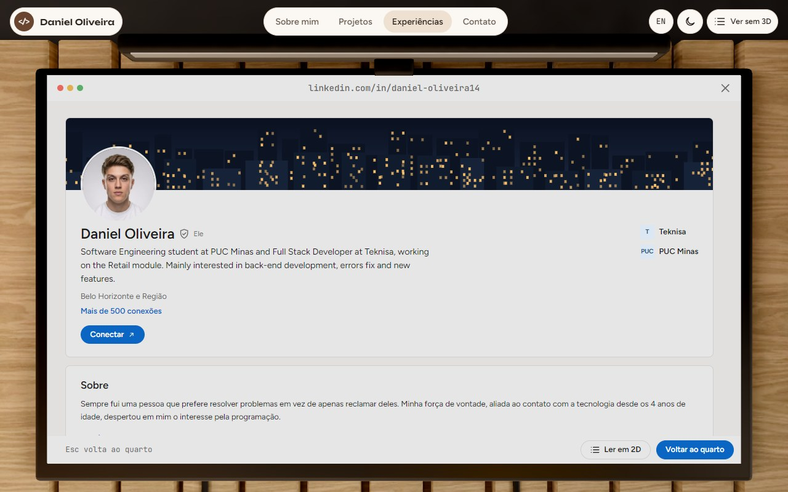
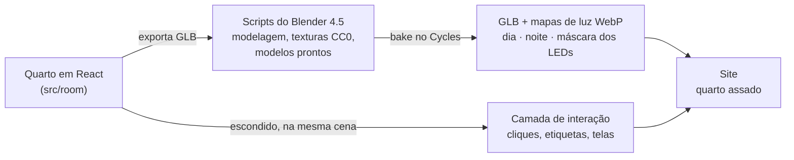

# Daniel Oliveira · Portfólio em Quarto 3D

**Um portfólio para entrar.** O meu quarto de verdade, refeito em 3D: cada objeto abre uma parte da minha história profissional, e a câmera voa até ele.

**No ar:** [www.danielolv.dev](https://www.danielolv.dev) · **Como foi feito:** [estudo de caso](docs/estudo-de-caso/README.pt-BR.md) · **English:** [README.md](README.md)



## O que tem no quarto

| Objeto | Abre | Como é |
| --- | --- | --- |
| Monitor | **Projetos** | O meu perfil do GitHub como está hoje: README do perfil, repositórios fixados, gráfico de contribuições e todos os repositórios públicos, buscados no build |
| TV | **Experiências** | O meu perfil do LinkedIn: título, sobre, experiência, formação, licenças e certificados e competências |
| Celular na cama | **Contato** | Uma tela inicial no estilo do iPhone; o app E-mail é um formulário de contato de verdade (EmailJS) |
| Porta-retrato na estante | **Sobre mim** | Quem eu sou, o que estudo e do que gosto |
| A luminária "&" | **Dia / noite** | Troca entre o fim de tarde dourado e a noite chuvosa na cidade |

Também existe um **modo sem 3D**, com o mesmo conteúdo numa página comum (para celulares mais fracos, leitores de tela e quem só quer ler). Tudo está em **português e inglês**.

<table>
  <tr>
    <td></td>
    <td></td>
  </tr>
</table>

## Destaques

- **Luz assada.** A luz é calculada antes, no Blender (Cycles), por um pipeline em script: um mapa de luz para o dia, um para a noite e uma máscara para os LEDs. O navegador só pinta texturas, então não existe nenhuma luz em tempo real.
- **O código continua sendo a fonte da verdade.** O quarto é montado primeiro em React (`src/room/`). Um script exporta a cena, scripts do Blender modelam as peças detalhadas e trocam algumas por modelos prontos, e o bake volta como um GLB. Refazer o quarto inteiro é um comando.
- **Camada de interação invisível.** O quarto feito em código continua montado, só que escondido, junto do quarto assado. Ele cuida dos cliques, das etiquetas, do hover e da cadeira que se mexe, e o assado copia o movimento.
- **Telas vivas.** Quando a câmera para na frente do monitor, da TV ou do celular, uma camada HTML é posta exatamente sobre a tela 3D. Antes disso, uma textura em canvas desenha a mesma página, com as cores calibradas por causa do tone mapping, para a troca não dar salto.
- **Dados reais.** O `scripts/github.mjs` roda antes de cada build e busca o meu perfil do GitHub, os fixados, o README do perfil, a foto e o calendário de contribuições. Se o GitHub estiver fora, vale a última cópia salva.
- **Uma janela viva.** Sol dourado de dia e cidade chuvosa à noite, desenhados ao vivo (`src/room/WindowView.jsx`).
- **Carregamento rápido.** O quarto começa a baixar antes de o React montar, com uma barra de progresso de verdade. Todo arquivo do quarto tem versão (`?v=`) e fica em cache por um ano. O celular baixa um GLB mais leve (5 MB em vez de 12,6 MB).
- **Pronto para compartilhar.** Cartão de link (Open Graph), dados estruturados (`Person` do schema.org), sitemap e o conteúdo em texto para buscadores e navegadores sem JavaScript.

## Como foi feito



### Tecnologias

- **Web:** React 18, Vite 6, three.js 0.164, React Three Fiber 8, drei 9, camera-controls, postprocessing, EmailJS
- **3D:** Blender 4.5 LTS controlado por scripts Python (`pipeline/blender/`), bake no Cycles, texturas WebP, Draco
- **Ferramentas:** ESLint 9, Prettier 3, Playwright (scripts de captura, desempenho e inventário), GitHub Actions
- **Hospedagem:** Vercel, com domínio próprio

### Estrutura

```
src/
  app/        a casca da página: menu, painéis, carregamento, tema e idioma
  scene/      Canvas, câmera (um ponto de vista por seção), efeitos
  room/       o quarto feito em código (camada de interação + fonte do bake)
  baked/      o quarto assado: carregamento, materiais, progresso
  screens/    telas do monitor (GitHub), da TV (LinkedIn) e do celular (iOS)
  sections/   Sobre mim, Projetos, Experiências, Contato, Créditos (painel e modo 2D)
  content/    todo o texto em PT e EN, dados do GitHub e do LinkedIn
pipeline/     exportar → Blender → bake → otimizar (veja pipeline/README.md)
scripts/      dados do GitHub, capturas, imagem de prévia do link, desempenho
docs/         plano, créditos, métricas e histórico
```

## Como rodar

```bash
npm install
npm run dev        # http://localhost:5173
npm run check      # lint + formatação + build (o mesmo do CI)
```

O formulário de contato precisa de uma conta no [EmailJS](https://www.emailjs.com). Copie o `.env.example` para `.env.local` e preencha `VITE_EMAILJS_SERVICE_ID`, `VITE_EMAILJS_TEMPLATE_ID_FOR_ME`, `VITE_EMAILJS_TEMPLATE_ID_FOR_SENDER` e `VITE_EMAILJS_PUBLIC_KEY`. Sem elas, o formulário avisa que o envio não está configurado.

Refazer o bake precisa do Blender 4.5 LTS e, de preferência, de uma GPU NVIDIA: `npm run previa` gera uma prévia rápida, e `npm run bake` faz o bake completo (cerca de uma hora). O passo a passo está em [`pipeline/README.md`](pipeline/README.md).

## Desempenho

A versão 1, com luz em tempo real, tinha **459 draw calls** e rodava a **37 FPS** num celular simulado (CPU 4× mais lenta). Hoje, com a luz assada, modelos e texturas de verdade, são **162 draw calls** e **87 FPS** no mesmo teste (medido em 23/10/2026). A história completa está no [estudo de caso](docs/estudo-de-caso/README.pt-BR.md), e as medições em [`docs/metricas/`](docs/metricas/).

## Créditos

Os modelos 3D do Sketchfab são usados sob a licença **[CC BY 4.0](https://creativecommons.org/licenses/by/4.0/)**:

- Pioneer DJ console, de twopixels.studio
- KRK Classic 5, de TheGiwi
- Ps5, de kiarash8585
- JBL Charge 3, de Oleksii.Rozumnyi
- Deadpool Funko Pop, de JJTale
- funko harry potter, de deathcow
- Fleetwood Bounder, de Zack_Hawley
- Nike SB Dunk Low Chunky Dunky, de ShoesPlug

As texturas e modelos do [Poly Haven](https://polyhaven.com) são **CC0**. Todos os modelos mudaram de escala, tiveram os polígonos reduzidos e foram convertidos para glTF, e a JBL também mudou de cor. A lista completa com os links está em [`docs/creditos.md`](docs/creditos.md) e no botão **Créditos** do site.

Estudei [Bruno Simon](https://bruno-simon.com/), [Henry Heffernan](https://henryheffernan.com/) e o [Room_Portfolio](https://github.com/AT010303/Room_Portfolio) para ter ideias. O Room_Portfolio não tem licença, então nada foi copiado dele: as técnicas foram refeitas do zero.

## Licença

O código está sob a [Licença MIT](LICENSE). Os modelos e texturas de terceiros continuam com as licenças deles (veja acima).

## Autor

**Daniel Oliveira de Menezes**: estudante de Engenharia de Software na PUC Minas e estagiário de desenvolvimento Full Stack na Teknisa.
[LinkedIn](https://www.linkedin.com/in/daniel-oliveira14/) · [GitHub](https://github.com/Danielolv14) · [danielolv.dev](https://www.danielolv.dev)

O projeto começou como o LAB01 da disciplina Desenvolvimento e Integração de Aplicações Web, na PUC Minas, e virou o meu portfólio profissional.
