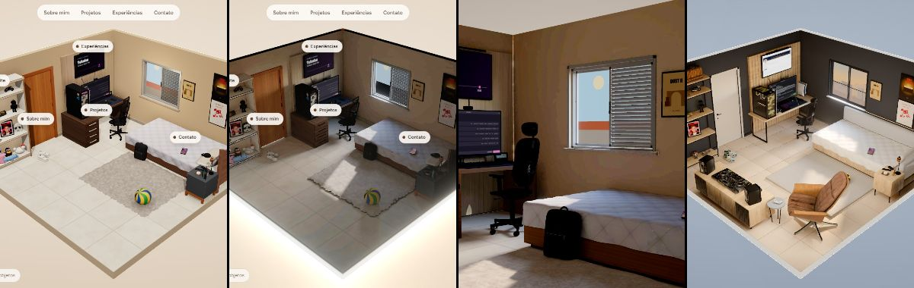
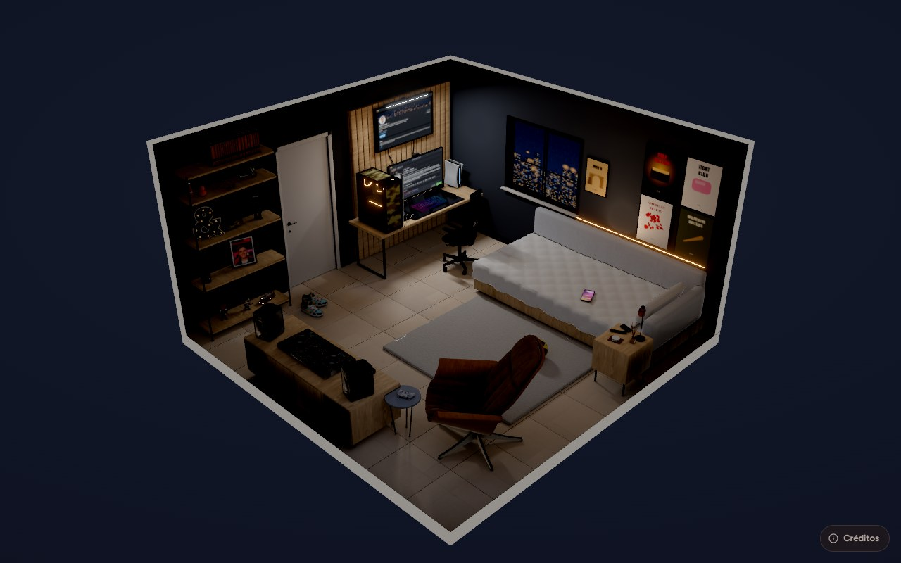

# How I turned my bedroom into a 3D portfolio

**[Português](README.pt-BR.md)** · Live: [www.danielolv.dev](https://www.danielolv.dev) · Code: [github.com/Danielolv14/portfolio-3d](https://github.com/Danielolv14/portfolio-3d)

Instead of a scrolling page, my portfolio is my real bedroom, rebuilt in 3D. The monitor opens my projects (as a GitHub-style profile), the TV opens my experience (LinkedIn-style), the phone on the bed opens the contact form and the photo frame opens "About me". This is how it went from a college assignment to what is live today, and what I learned along the way.

## 1. The idea

It started as LAB01 of the Web Application Development and Integration course at PUC Minas: a portfolio with About, Projects, Experience and Contact. Almost everyone builds a scrolling page. I wanted something people would remember: the place where I actually code, with every object telling a part of my story.

## 2. Version 1: the whole room in code

The first version was built entirely in React Three Fiber from photos of the room: walls, desk, bed, shelf, a keyboard modeled key by key, every object made of simple shapes and textures drawn on `<canvas>`.

It worked, and it was handed in. But two limits showed up:

- **It looked like a game.** With real-time lights, the room had none of the bounced light and soft shadows of a real space. It looked like an old video game, not a photo.
- **It was heavy.** 422 meshes, 8 lights and 309 shadow casters: **459 draw calls** and **37 FPS** on a simulated phone (4× CPU slowdown).

## 3. Why the beautiful rooms look like renders

Studying 3D portfolios that looked like photos, the answer was always the same: **the light isn't computed in the browser**. It is baked beforehand in a 3D tool like Blender, with real global illumination, and the site only paints those light textures. The browser barely works, and the image looks like a render.

The catch: people who do this usually model everything by hand in Blender, and I had a whole room in code, with clicks, screens and animations I didn't want to lose.

## 4. The trick: code as the source, Blender as the compiler

I didn't replace the code with Blender. I made Blender **compile** the room that already existed:

1. **Tag the scene.** Every piece of the React room sits inside a `<Bake group kind>` component that says whether it is a wall, furniture or an object, and whether it is static, clickable, a live screen or glass. That travels with the mesh into the GLB.
2. **Export.** A script opens the site with Playwright and exports the assembled scene to GLB.
3. **Model and dress.** Python scripts in Blender 4.5 swap some areas for more detailed models (the metal shelf, the desk, the bed), apply CC0 photo textures from Poly Haven tinted to the room's palette, and bring in ready-made Sketchfab models (CC BY), converted to real-world size with fewer polygons.
4. **Bake the light in Cycles** into three maps: **day** (a golden late afternoon), **night** and an **LED mask** where each color channel is one light source (the strip behind the headboard, the TV light bar and the PC's RGB). On the site, the LED colors are mixed live.
5. **Optimize and ship.** It comes back as a Draco GLB with WebP textures, in a desktop version and a lighter one for phones.

A full bake takes about 50 minutes on an NVIDIA GPU. To iterate, I use a **quick preview** (40 seconds to 2 minutes) from fixed cameras, compared against a target image. Cycles sometimes crashes while preparing the meshes, so the script retries up to 3 times.

## 5. Decisions that made a difference

- **The invisible interaction layer.** The room built in code stays mounted, but hidden, in the same scene. three.js's raycaster hits invisible meshes, so clicks, labels and hover still come from the code. When something moves (the chair rolls out of the camera's way), the baked piece copies it: its matrix is the code piece's current world matrix times the inverse of its world matrix at bake time.
- **Sharp color, separate light.** At first the color was baked too, into an atlas shared by dozens of objects, and small objects came out blurry. Now each object uses its own color texture and the bake stores only the light.
- **The same tone mapping on both sides.** AgX in Blender and in three.js: the color I approve in the preview is the color on the site.
- **Screens that are real pages.** When the camera parks in front of the monitor, the TV or the phone, an HTML layer is placed exactly over the 3D screen, with its corners projected every frame. Before that, a canvas texture draws the same page with colors calibrated to survive tone mapping, so the swap doesn't jump.
- **Load before it's needed.** The room starts downloading in `main.jsx`, before React and three.js, with a progress bar driven by the GLB's bytes. Every file carries the bake version in its URL and is cached for a year.

## 6. Content inside the objects

- **Monitor = Projects**, styled as my GitHub profile as it is today. Before every build, a script fetches the profile, pinned repos, profile README, avatar and contribution graph. If GitHub is down, the last saved copy is used.
- **TV = Experience**, styled as my LinkedIn: experience, education, certifications and skills, light by day and dark at night.
- **Phone = Contact**, an iPhone-style home screen. The Mail app is a real form (EmailJS) with an auto-reply that doesn't echo the message, so the form can't be used to send spam.
- **The window is alive:** a golden sun by day and a rainy city at night, drawn live.
- **A 2D mode** with the same content as a regular page, for weak phones and screen readers.

## 7. Before and after

| | Version 1 (code) | First bake | Today |
| --- | --- | --- | --- |
| Draw calls | 459 | 38 | 162 |
| FPS on a simulated phone (4× CPU) | 37 | 168 | 87 |
| Lighting | 8 real-time lights | baked (day, night, LEDs) | baked (day, night, LEDs) |

The first bake was the lightest, but everything in it was simple shapes in flat colors. Today the room has real models and textures, each object with its own sharp color, and it still runs more than twice the frame rate of version 1 on the simulated phone. The GLB is 11.8 MB on desktop and 5.2 MB on phones.

## 8. What I learned (and would do differently)

- **A target image before modeling.** The clay-model stage, with bevels and flat colors, looked like play dough and was thrown away. Only after I fixed a realistic target image did the rounds of tweaks start to converge.
- **Code as the source of truth pays off.** Rebuilding the whole room is one command, and the layout, clicks and screens never left React.
- **Tone mapping lies.** With AgX, a pure yellow in the sun turns cream. The footvolley ball only got the right lemon yellow with a darker input color.
- **Look at the data, not just the picture.** To reproduce my ball's design (a Mikasa FT-5), I mapped the photo's colors onto a text grid: it is 32 triangles in a checkerboard (an octahedron with each face split in 4), not the 8 I had guessed.
- **Licenses from day one.** CC BY models require visible credit, so the site has a credits button. And the reference I studied has no license: only the techniques were studied, nothing was copied.
- **Still to do:** KTX2 textures (lighter on the GPU), Lighthouse in CI and tests on more real phones.

---

**Stack:** React 18, Vite 6, three.js, React Three Fiber, drei, camera-controls, postprocessing, EmailJS, Blender 4.5 (Python and Cycles), Playwright and Vercel.

**Daniel Oliveira de Menezes**: [LinkedIn](https://www.linkedin.com/in/daniel-oliveira14/) · [GitHub](https://github.com/Danielolv14) · [danielolv.dev](https://www.danielolv.dev)
