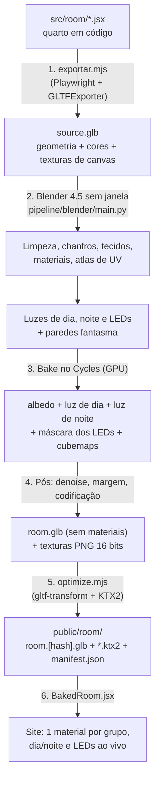

# Fase 1 — Pipeline código → Blender → site

O coração do salto visual. O quarto continua sendo montado em React. Um comando exporta a cena, o Blender (sem abrir janela) assa a luz no Cycles, e o site passa a desenhar a versão assada.

**Fase 1a (prova de conceito):** M. **Fase 1b (quarto inteiro):** G. **Marcos:** M1 e M2.

> **Situação em 21/10/2026:** Fase 1a feita. Resultados e ajustes para a 1b em [resultados-poc.md](resultados-poc.md). Como rodar: [`pipeline/README.md`](../../pipeline/README.md).

---

## 1. Visão geral



Um comando faz tudo:

```bash
npm run bake
```

Variações:

```bash
npm run bake -- --preview
```

```bash
npm run bake -- --group=props --stage=bake
```

- `--preview`: metade da resolução, 64 amostras e denoise. Leva minutos, para testar ideias.
- `--group`: refaz só um grupo de atlas.
- `--stage`: começa de uma etapa (`export`, `build`, `bake`, `post`, `optimize`).
- **Cache:** cada etapa guarda o hash da entrada (GLB exportado + `bake.json` + scripts). Se nada mudou, a etapa é pulada.

## 2. Ferramentas

| Ferramenta | Para quê | Instalação |
|---|---|---|
| Blender **4.5 LTS** | Montar, iluminar e assar | `winget install BlenderFoundation.Blender.LTS.4.5` |
| KTX-Software (`ktx`) | Comprimir texturas em KTX2 | `winget install KhronosGroup.KTX-Software` |
| `@gltf-transform/cli` | Otimizar o GLB (meshopt, dedup) e chamar o KTX | dependência de desenvolvimento do npm |
| `playwright-core` + Edge | Abrir a página de export e baixar o GLB | já instalado |

O caminho do Blender fica em `pipeline/config/local.json` (ignorado pelo git), com um padrão para Windows. O script confere `bpy.app.version` e avisa se a versão não for a esperada.

A GTX 1660 Super (6 GB) renderiza no Cycles por CUDA. O OptiX também funciona nela, sem os núcleos de RT. Na 1a mede-se qual é mais rápido.

## 3. Etapa 1 — Exportar a cena (`pipeline/export/exportar.mjs`)

- **Página só de export:** `src/export/` vira uma segunda entrada do Vite (`export.html`), só em desenvolvimento. Ela desenha **apenas** o `<Room>` em código, num estado fixo: dia, cadeira encostada, sem etiquetas, sem efeitos e sem hover.
- **Espera ficar pronto:** fontes carregadas (`document.fonts.ready`), texturas de canvas desenhadas e dois quadros renderizados.
- **Exporta:** `GLTFExporter.parse(scene, { binary: true, onlyVisible: true })`. Os nomes das malhas (convenção da [Fase 0](01-fundacao.md#05-preparar-o-quarto-em-código-para-ser-exportado)) e o `userData` vão junto como *extras*.
- **Salva:** `pipeline/.cache/source.glb` e um `source.json` com a contagem de malhas por prefixo, para conferência.

**Lista de verificação do export** (testada na 1a):

| Item | O que pode dar errado | Como tratar |
|---|---|---|
| Texturas de canvas com `repeat` | Perder a repetição | O exporter grava `KHR_texture_transform`, que o importador do Blender entende; conferir na madeira e no piso |
| Texto em canvas (pôsteres, relógio) | Fonte ainda não carregada | Esperar `document.fonts.ready` |
| `meshPhysicalMaterial`, materiais com `onBeforeCompile` | Propriedades perdidas | Marcar como `metal-` ou `glass-`, tratados no Blender pela biblioteca de materiais |
| Telas (monitor, TV e celular) | Conteúdo dinâmico | Exportar só como `screen-`. A textura de repouso entra no bake como emissão, mas a tela é desenhada ao vivo |
| Áreas de clique invisíveis | Viram paredes no bake | Prefixo `skip-` e `onlyVisible` |
| `Html` (etiquetas) | Não é 3D | Não exporta (certo) |

## 4. A escolha mais importante: o que assar

Duas formas de guardar a luz:

| | **A. Cor e luz juntas** (como a referência) | **B. Albedo em atlas + lightmaps separados** (proposta) |
|---|---|---|
| Texturas | dia (4096) + noite (4096) + máscara | albedo (4096) + luz de dia (2048) + luz de noite (2048) + máscara (2048) |
| Peso | 2 texturas grandes por grupo | 1 grande + 3 com ¼ da área |
| Nitidez dos detalhes (pôster, madeira) | Igual (4096) | Igual (4096) |
| Cor dos LEDs ao vivo | Só aproximada (`blendLighten`) | **Fisicamente certa**: luz do LED × cor × albedo |
| Mudar a cor de um objeto | Refazer o bake | Refazer só o albedo (rápido) |
| Shader | 3 leituras | 4 leituras |

**Recomendação: B.** A luz muda devagar na superfície, então pode ter metade da resolução sem perder nada visível. A prova de conceito confere se as sombras de contato dos objetos pequenos continuam nítidas a 2048. Se não, sobe só o lightmap do grupo `props`.

### Grupos de atlas

| Grupo | O que entra | Albedo | Lightmaps | Celular |
|---|---|---|---|---|
| `shell` | Paredes, piso, laje, rodapé, porta, janela | 4096 | 2048 | metade |
| `furniture` | Mesa, gaveteiro, nicho, cama, criado-mudo, painel, TV, gabinete | 4096 | 2048 | metade |
| `props` | Objetos pequenos, decoração, partes que se mexem | 4096 | 2048 | metade |

Densidade de referência: o grupo `shell` tem cerca de 210 unidades² visíveis, o que dá ~280 px por unidade (~900 px por metro) no albedo.

## 5. Etapa 2 — Montar no Blender (`pipeline/blender/`)

Roda com `blender --background --factory-startup --python pipeline/blender/main.py -- --config pipeline/config/bake.json`. Cada passo é um arquivo pequeno, chamado em ordem pelo `main.py`:

| Arquivo | Faz |
|---|---|
| `00_importar.py` | Cena vazia, importa o `source.glb` e confere a contagem por prefixo |
| `10_limpar.py` | Junta vértices duplicados (*merge by distance*), recalcula normais, remove `skip-`, aplica a escala nas partes fixas e **mantém o pivô** das partes `dyn-` (a cadeira precisa girar no lugar certo) |
| `20_chanfrar.py` | Modificador **Bevel** por ângulo (30°), 2 segmentos, largura proporcional ao tamanho da peça (0,008–0,02 unidade), mais **Weighted Normal**. Pula as peças que já são arredondadas ou têm `noBevel` |
| `30_tecidos.py` | Gera edredom, travesseiros e almofada por **simulação de pano** (ver [04](04-modelagem-e-arte.md#tecidos-por-simulação)) |
| `35_arte.py` | Troca marcadores por modelos feitos à mão de `art/*.blend`, pelo mesmo nome e posição (só se a pergunta P2 for "sim") |
| `40_materiais.py` | Biblioteca de materiais: transforma o material simples do glTF num material do Cycles melhor, com rugosidade com variação, *sheen* em tecidos, verniz na madeira, porcelanato e metal |
| `50_uv.py` | Cria o mapa de UV `bake` por grupo: *Smart UV Project* + empacotamento (*Pack Islands*), com margem e peso por importância (faces vistas de perto ganham mais área) |
| `55_faces_ocultas.py` | (otimização) Apaga faces que nunca aparecem: fundo dos móveis, costas encostadas na parede. Testa com raios saindo dos pontos de câmera do site |
| `60_luzes.py` | Monta os três "rigs" de luz e as **paredes fantasma** (ver [03](03-iluminacao.md)) |

Detalhe que evita retrabalho: **materiais compartilhados entre grupos** (ex.: o preto usado em vários lugares) são duplicados por grupo antes do bake. Cada grupo assa na sua própria imagem.

## 6. Etapa 3 — Assar (`70_assar.py`)

Configuração do Cycles: GPU, *light paths* com 8 rebatidas difusas, *clamp* indireto em 10 (evita pontinhos brilhantes) e margem de 16 px do tipo *extend*.

| Passo | Tipo de bake | Configuração | Resultado |
|---|---|---|---|
| Albedo | Diffuse, só **Color** | 16 amostras | A cor pura de cada superfície, sem luz |
| Luz de dia | Diffuse, **Direct + Indirect**, sem Color | rig de dia; 512 amostras (64 no preview) | Quanta luz chega em cada ponto (irradiância), em float |
| Luz de noite | Igual | rig de noite | Idem |
| Máscara R/G/B | Igual, um LED de cada vez | só aquele LED aceso, branco, força 1; céu preto | A luz de cada LED, separada |
| Cubemaps | Render panorâmico (câmera equirretangular no meio do quarto) | dia e noite, 1024×512 | Reflexos para metal e vidro no site |

Como assar vários objetos numa imagem só: em cada material do grupo, o script cria um nó *Image Texture* (desconectado) apontando para a imagem do grupo e o deixa **ativo**. Seleciona todos os objetos do grupo e assa de uma vez.

Tempos estimados na GTX 1660 Super: **5–10 min no preview** e **40–90 min no final**. A 1a mede o tempo real.

## 7. Etapa 4 — Pós-processamento (`80_pos.py`)

1. **Denoise:** passa cada lightmap pelo nó *Denoise* (OIDN) do compositor. A luz assada é suave, então o denoise funciona bem e permite usar menos amostras.
2. **Margem de novo:** o denoise pode escurecer as bordas das ilhas. O script refaz a margem preenchendo os pixels fora das ilhas com a cor do vizinho (usando uma máscara de cobertura do UV).
3. **Codificação da luz em 8 bits** (a luz passa de 1, o PNG não):
   - escala `S` = percentil 99,9 da imagem (guardado no `manifest.json`);
   - `valor = (luz / S)^(1/2.2)`. A raiz dá mais precisão às partes escuras, onde o olho percebe faixas;
   - no site: `luz = valor^2.2 × S`.
4. **Albedo:** salvo em sRGB.
5. Tudo sai como PNG de 16 bits em `pipeline/.cache/out/`. A compressão final é na etapa 5.

## 8. Etapa 5 — Exportar e otimizar

- **`90_exportar.py`:**
  - junta as partes fixas de cada grupo numa malha só (1 draw call por grupo);
  - mantém separadas as partes `dyn-`, `hs-`, `screen-`, `emit-`, `metal-` e `glass-`;
  - exporta um GLB **sem materiais e sem normais** (o material é montado no site; normais só ficam em `metal-` e `glass-`), com o UV `bake` como `TEXCOORD_0` e os *extras* (grupo, tipo).
- **`pipeline/optimize/optimize.mjs`:**
  - `gltf-transform`: `dedup`, `weld`, `meshopt` com quantização;
  - texturas para **KTX2**: albedo em ETC1S (pequeno), lightmaps e máscaras em UASTC (sem faixas). Gera duas versões: completa e `-mobile` (metade);
  - escreve `public/room/manifest.json`: nomes com hash, escalas `S`, cores padrão dos LEDs e versão do bake.

## 9. Etapa 6 — O site desenhando a versão assada

Arquivos novos em `src/baked/`:

- **`BakedRoom.jsx`:** lê o `manifest.json`, carrega o GLB (`useGLTF` + decodificador meshopt) e as texturas (`KTX2Loader`, escolhendo a versão do celular quando a tela é pequena), monta os materiais e percorre os nós pelo prefixo.
- **`BakedMaterial.js`:** um `ShaderMaterial` com este cálculo por pixel:

  ```glsl
  vec3 albedo = texture2D(albedoMap, vUv).rgb;
  vec3 luzDia = pow(texture2D(lightDay, vUv).rgb, vec3(2.2)) * scaleDay;
  vec3 luzNoite = pow(texture2D(lightNight, vUv).rgb, vec3(2.2)) * scaleNight;
  vec3 leds = pow(texture2D(ledMask, vUv).rgb, vec3(2.2)) * scaleLed;
  vec3 luz = mix(luzDia, luzNoite, uNight)
           + leds.r * uLedColor0 * uLedPower0
           + leds.g * uLedColor1 * uLedPower1
           + leds.b * uLedColor2 * uLedPower2;
  gl_FragColor = vec4(albedo * luz * uExposure, 1.0);
  #include <tonemapping_fragment>
  #include <colorspace_fragment>
  ```

  Dá para trocar a cor do RGB do gabinete ao vivo e ela ilumina o quarto do jeito certo.
- **Ligação com o que já existe:**
  - `screen-*` mantém o nome, então `screens.js`, `ScreenTracker` e `ScreenOverlay` continuam iguais;
  - `hs-*` passa a usar o `Hotspot` adaptado para receber um nó do GLB em vez de filhos JSX;
  - `dyn-chair` recebe a animação da cadeira (saída do caminho da câmera). Como a sombra dela está assada no chão, ela leva junto uma "mancha de sombra" própria (um plano com degradê) e fica fora do bake de sombra das partes fixas;
  - `emit-*` usa material básico com `toneMapped={false}`, com intensidade ligada a `dayNight.mix` e à cor do LED. O Bloom pega o que passa de 1;
  - `metal-*` e `glass-*` usam `MeshStandardMaterial` com o cubemap assado como `envMap`, misturando dia e noite.
- **Câmera e pontos de vista** (`SPOTS`): não mudam, porque o export preserva as coordenadas.
- **Chave de comparação:** `?render=source` desenha o quarto em código com luz em tempo real, como hoje. Fica só para desenvolvimento e comparação.
- **Some do site:** as 7 luzes em tempo real, o `BakeShadows`, o N8AO e os truques de emissivo falso. O `ToneMapping` passa para **AgX**, o mesmo do Blender, para o site e o Blender combinarem.

## 10. Fase 1a — Prova de conceito

**Escopo:** só o grupo `shell` (paredes, piso, laje, rodapé, janela) e a cama com o criado-mudo e a luminária de cobre (emissor da noite). Dia e noite, 1 LED de teste.

**Testes (cada um com captura e conclusão anotada em `docs/plano/resultados-poc.md`):**

| Teste | Pergunta | Como |
|---|---|---|
| Cor | O site mostra a mesma cor que o Blender? | Render do Cycles por uma câmera igual à do site × captura do site; diferença média por canal < 3% |
| Emendas | Aparecem linhas nas bordas das ilhas? | Capturas de perto, de longe e com KTX2 ligado |
| Faixas | O degradê da noite tem degraus? | Captura da parede à noite com contraste aumentado |
| Resolução | 1024, 2048 ou 4096 no lightmap? | Mesma captura nas três; escolher a menor sem perda visível |
| Formato | ETC1S × UASTC × webp | Peso, nitidez e memória |
| Tempo | Quanto leva o bake? | Preview e final, CUDA × OptiX |
| Desempenho | Draw calls e FPS no celular simulado | `scripts/desempenho.mjs` |

**Saída da 1a:** a tabela de resultados e a confirmação (ou troca) das decisões T1–T5.

## 11. Fase 1b — Quarto inteiro

1. Grupos `furniture` e `props`, todas as partes `dyn-`, `hs-`, `emit-`, `metal-` e `glass-`.
2. Rigs de dia, noite e LEDs completos ([03](03-iluminacao.md)).
3. `BakedRoom` vira o padrão. O modo `source` fica só como chave de desenvolvimento.
4. Remover luzes em tempo real, `BakeShadows`, N8AO e emissivos falsos.
5. Capturas nos 8 ângulos e métricas novas em `docs/metricas/`.
6. `pipeline/README.md` explicando como qualquer pessoa roda o bake (pré-requisitos, comandos, tempo, problemas comuns).

**Pronto quando:**
- [ ] `npm run bake` refaz tudo do zero sem intervenção
- [ ] O site usa a versão assada, com dia e noite e LEDs ao vivo
- [ ] < 80 draw calls na visão geral; ≥ 50 FPS no celular simulado
- [ ] Nenhuma emenda visível nos 8 ângulos
- [ ] Telas, celular, cadeira e hotspots funcionam como antes
- [ ] Modo sem 3D intacto
