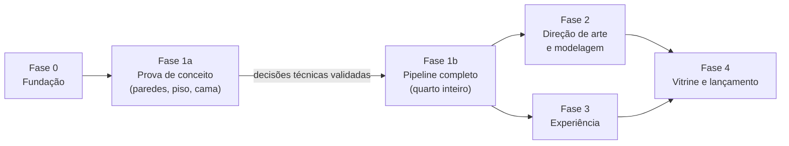

# Plano da versão profissional

Este é o plano para levar o portfólio de "trabalho de faculdade bem feito" a **projeto de referência**: um quarto 3D com cara de render, rápido no celular, e com um repositório que as pessoas abram e queiram replicar.

Começou em 21/10/2026. Não tem datas: cada fase termina quando cumpre os critérios dela, não quando o calendário manda. O esforço usa a escala **P** (até meio dia), **M** (1 a 3 dias) e **G** (mais de 3 dias).

## Como ler

| Documento | O que tem |
|---|---|
| [README.md](README.md) (este) | Visão geral, princípios, decisões, fases, marcos, riscos e perguntas em aberto |
| [01-fundacao.md](01-fundacao.md) | Fase 0: arrumar a casa antes de construir (repositório, build, deploy, linha de base) |
| [02-pipeline-blender.md](02-pipeline-blender.md) | Fase 1: o pipeline código → Blender → site, passo a passo |
| [03-iluminacao.md](03-iluminacao.md) | O desenho da luz: dia, noite, LEDs, cor e exposição |
| [04-modelagem-e-arte.md](04-modelagem-e-arte.md) | Fase 2: direção de arte, modelagem nova e detalhes |
| [05-experiencia.md](05-experiencia.md) | Fase 3: abertura, interações, sons, navegação e desempenho |
| [06-vitrine-e-lancamento.md](06-vitrine-e-lancamento.md) | Fase 4: README, estudo de caso, SEO, domínio e lançamento no LinkedIn |
| [07-ideias.md](07-ideias.md) | Ideias do Daniel e ideias extras, com o lugar de cada uma no plano |

O porquê de tudo isso está no [estudo visual do Room_Portfolio](../planejamento/estudo-visual-room-portfolio.md).

---

## 1. Objetivo

Três coisas, nesta ordem:

1. **Bonito como um render.** Luz suave, sombras de contato, luz rebatida, quinas que pegam brilho e cores com contraste. Quem abre o site tem que achar que é um vídeo.
2. **Leve e fluido.** Abre rápido, roda liso num celular médio e nunca deixa a pessoa sem conteúdo (o modo sem 3D continua).
3. **Replicável.** O repositório explica como foi feito, com um pipeline que qualquer pessoa consegue rodar e um estudo de caso que conta as decisões.

### Metas medíveis

| Métrica | Hoje (aprox.) | Meta |
|---|---|---|
| Draw calls na visão geral | ~495 | **< 80** |
| Luzes em tempo real | 7 + Environment | **0–2** (só reflexos) |
| FPS no celular simulado (CPU 4x) | 25–33 | **≥ 50** |
| Download até o quarto aparecer | ~1,6 MB (sem texturas reais) | **< 3 MB** (texturas leves primeiro) |
| Download total, com texturas completas | — | **< 12 MB** no computador, **< 6 MB** no celular |
| Memória de GPU das texturas | — | **< 120 MB** no computador, **< 60 MB** no celular |
| Lighthouse (computador) | não medido | **Desempenho ≥ 85, Acessibilidade ≥ 95, SEO ≥ 95** |

Os números de hoje são medidos de novo na Fase 0, porque viram a linha de base do estudo de caso ("antes e depois").

## 2. Princípios (valem para todas as fases)

1. **O código é a fonte da verdade.** O quarto continua sendo montado em React (`src/room/`). O Blender é uma **etapa de build**, como um compilador: recebe a cena exportada e devolve a cena assada. Nenhuma edição manual de `.blend` é necessária para refazer o resultado.
2. **Tudo é reproduzível com um comando.** `npm run bake` refaz tudo; `npm run bake -- --preview` faz uma versão rápida para testar.
3. **Base real, com direção de arte.** O layout e os objetos vêm do quarto do Daniel. Tons, contraste, luz e detalhes podem ser ajustados para a imagem ficar mais bonita.
4. **Nada de terceiros sem licença.** Modelos, texturas, sons e fontes são nossos ou têm licença livre e registrada (CC0, OFL, MIT). Da referência (Room_Portfolio) só estudamos técnicas.
5. **Medir antes e depois.** Toda mudança de visual ou desempenho tem captura nos mesmos ângulos e número de draw calls e FPS. Essas imagens alimentam o estudo de caso.
6. **Nunca quebrar o que funciona.** Cada fase termina com o site no ar funcionando. O pipeline novo entra atrás de uma chave até ficar melhor que o atual.
7. **Simples de explicar.** O Daniel apresenta e explica o projeto. Código legível, comentários curtos em português explicando o porquê.

## 3. Decisões tomadas

| # | Decisão | Quando |
|---|---|---|
| D1 | A luz vem de um **bake no Cycles feito por script** (Blender em modo sem janela) | 21/10 |
| D2 | **Base real com direção de arte** | 21/10 |
| D3 | Replicar = **vitrine + estudo de caso**, não um template genérico | 21/10 |
| D4 | O site oficial é o projeto Vercel `portfolio-3d-wyhb` | 21/10 |
| D5 | EmailJS só no lançamento no LinkedIn | 21/10 |
| D6 | Continuam valendo: conteúdo das telas como camada HTML, monitor = Projetos, TV = Experiências, celular = Contato, porta-retrato = Sobre mim, luminária "&" = dia/noite, modo sem 3D, sem WhatsApp, MinhaReceita sem link, `referencias/` privada | antes |

**Decisões técnicas propostas neste plano** (explicadas nos documentos de cada fase):

- **T1 — Albedo assado em atlas e luz em lightmaps separados** (de dia, de noite e a máscara dos LEDs), em vez de assar cor e luz juntas como a referência. Fica mais leve (a luz é suave e pode ter metade da resolução) e permite trocar a cor dos LEDs ao vivo. Ver [02](02-pipeline-blender.md#4-a-escolha-mais-importante-o-que-assar).
- **T2 — Paredes "fantasma" só para o bake:** as duas paredes da frente e o teto existem no Blender para a luz se comportar como num quarto fechado, mas não vão para o site.
- **T3 — Texturas em KTX2** (comprimidas na GPU), com versão menor para o celular.
- **T4 — Blender 4.5 LTS fixado** (suporte até 2027 e API estável para scripts). Ver pergunta P1.
- **T5 — Sem luzes em tempo real.** Os reflexos de metal e vidro vêm de um cubemap também renderizado no Cycles.

## 4. Fases

| Fase | Entrega | Esforço | Documento |
|---|---|---|---|
| **0 — Fundação** | Repositório organizado, build com cache correto, deploy automático confiável, nomes nas malhas, linha de base medida | M | [01](01-fundacao.md) |
| **1a — Prova de conceito** | Paredes, piso e cama assados e rodando no site, com as escolhas de cor, compressão e resolução validadas | M | [02](02-pipeline-blender.md) |
| **1b — Pipeline completo** | Quarto inteiro assado com um comando, dia e noite, LEDs ao vivo, site trocando para a versão assada | G | [02](02-pipeline-blender.md), [03](03-iluminacao.md) |
| **2 — Arte e modelagem** | Paleta e luz finais, chanfros, tecidos simulados, objetos novos e mais detalhes | G (em ciclos) | [04](04-modelagem-e-arte.md) |
| **3 — Experiência** | Abertura cinematográfica, contorno no hover, TV = Experiências, sons, URL por seção, acessibilidade por teclado, celular afinado | G | [05](05-experiencia.md) |
| **4 — Vitrine e lançamento** | README EN/PT, estudo de caso, vídeo, SEO, domínio, EmailJS, post no LinkedIn | M | [06](06-vitrine-e-lancamento.md) |

As Fases 2 e 3 podem andar em paralelo depois da 1b, porque mexem em partes diferentes (arte = `src/room/` e `pipeline/`; experiência = `src/scene/` e UI).

## 5. Marcos (o que dá para mostrar em cada um)

| Marco | Como saber que chegou | Prova |
|---|---|---|
| M0 — Casa arrumada | Push na `main` publica sozinho; `npm run build` gera arquivos com hash; métricas de hoje registradas | Captura dos 8 ângulos padrão + tabela de métricas em `docs/metricas/` |
| M1 — "Funciona!" | A cama e o piso assados aparecem no site, sem emendas visíveis, com dia/noite | Imagem lado a lado antes/depois |
| M2 — Quarto assado | O site inteiro usa a versão assada, < 80 draw calls, LEDs trocam de cor ao vivo | Vídeo curto + métricas |
| M3 — Cara de referência | Comparação lado a lado com o Room_Portfolio em que o nosso não perde no visual | Painel de capturas |
| M4 — Experiência completa | Todas as seções nos objetos, abertura, sons, URL, teclado | Vídeo de 30 s |
| M5 — Lançado | Domínio, README, estudo de caso e post publicados | Links |

## 6. Riscos e como reduzir

| Risco | Impacto | Como reduzir |
|---|---|---|
| A cor do Blender não bate com a do site (gerenciamento de cor) | Alto | Validar na Fase 1a com uma cartela de cores assada e comparada pixel a pixel |
| Emendas e vazamentos nas bordas das ilhas de UV | Médio | Margem de 16 px no bake, preenchimento das bordas, testar com a compressão KTX2 ligada |
| Faixas (banding) na luz por causa dos 8 bits | Médio | Escala por atlas + curva gama + UASTC nos lightmaps; testar no 1a |
| O export do three.js perde algo (materiais, texturas repetidas) | Médio | Lista de verificação do export; testar cada área antes do bake |
| Bake demorado na GTX 1660 Super | Baixo | Modo `--preview`, bake por grupo, cache por hash |
| Memória de GPU no celular | Alto | KTX2 + versão 2048 para o celular |
| Modelagem orgânica (pelúcias, tênis) difícil por script | Médio | Tecidos por simulação em script; o resto decidido na pergunta P2 |
| O escopo crescer sem fim | Alto | Cada fase com critérios de pronto; ideias novas entram pela [lista de ideias](07-ideias.md) e são encaixadas numa fase |

## 7. Perguntas em aberto (decisões do Daniel)

| # | Pergunta | Recomendação |
|---|---|---|
| P1 | Blender 4.5 LTS ou 5.2? | **4.5 LTS**: o pipeline é um script, e a API do LTS não muda até 2027 |
| P2 | Objetos orgânicos (pelúcias, tênis, mochila, robô) podem ser modelados à mão no Blender, num `.blend` versionado em `art/`? | **Sim, só para esses**. Tecidos (edredom, travesseiros) saem por simulação em script |
| P3 | O repositório fica em inglês com tradução em português, ou o contrário? | **Inglês principal** (`README.md`) e `README.pt-BR.md`, para alcance internacional |
| P4 | Licença dos arquivos 3D e texturas assadas | Código MIT; **arte em CC BY 4.0** (podem usar com crédito) |
| P5 | Domínio próprio (ex.: `danieloliveira.dev`, cerca de US$ 12/ano)? | Sim, no lançamento |
| P6 | Clima do "dia": meio-dia claro ou fim de tarde dourado? | **Fim de tarde**: luz baixa e quente pela janela, o que dá mais contraste e beleza |
| P7 | Quais são as ideias novas? | Anotar em [07-ideias.md](07-ideias.md) antes de começar a Fase 2 |
